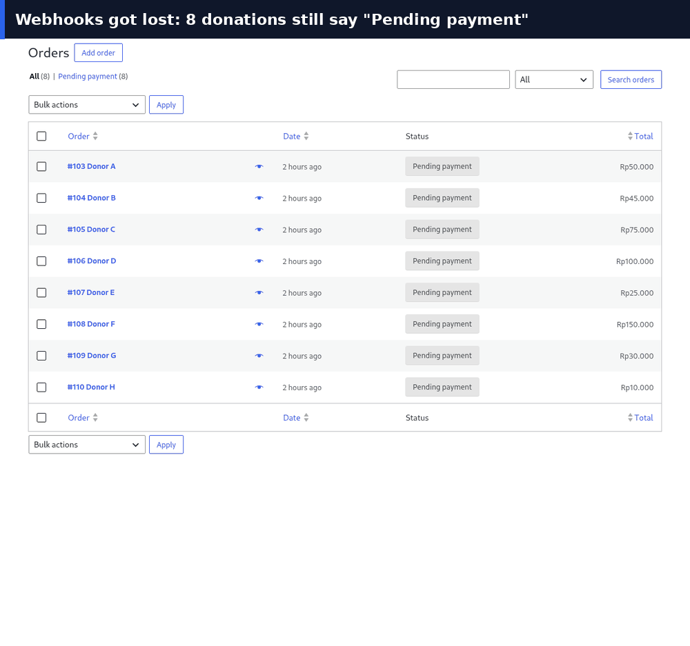

# Donation Guard

**Find donations stuck in "pending" and check their real status with Southeast Asian payment gateways.**

A WordPress plugin for nonprofits and fundraising sites that use **WooCommerce**, **GiveWP** or **DonasiAja** with **Midtrans**, **Xendit** or **Tripay**.




## The problem

Every donation site collects "pending" donations. During a busy campaign there can be hundreds, and nobody knows what they really are:

- **expired**: the donor opened a QR code or virtual account and never paid (this is most of them);
- **never created**: the gateway had an outage and no payment code was issued;
- **paid but missed**: the payment went through, but the callback never reached the site (server down, firewall, timeout), or the site answered the callback in a format the gateway rejects, so the gateway keeps retrying.

Until someone checks, campaign totals, conversion numbers for the ads team and reports to the board are guesses, and a donor who did pay may get no receipt. Checking means comparing the gateway dashboard with the site, one invoice at a time.

Donation Guard does that check for you, every hour. In most runs the answer is reassuring: "nothing is stuck, these 140 are simply unpaid". When something *is* stuck, it fixes it safely and tells you.

## What it does

| Gateway says | Donation Guard does |
|---|---|
| Paid, same amount | Marks the donation as paid through the donation plugin itself, so the donor gets the usual receipt |
| Paid, **different amount** | Changes nothing, flags it for a human |
| Expired / failed / cancelled | Marks as failed (can be turned off). On plugins without a failed status (DonasiAja) it only reports them, and stops re-checking them |
| Still pending | Leaves it |
| No payment code was ever issued | Reports it (checkout failed or gateway outage) |
| Refunded, not found, API error | Changes nothing, flags it for a human |

It also checks your **callback (webhook) URLs** on every run, the same way a gateway calls them, and warns about timeouts, server errors, redirects, firewall blocks and answers the gateway will reject (for example plain text where Tripay and Xendit expect JSON).

Safety first:

- **Dry-run is on by default.** It only reports until you switch it off.
- It only ever *reads* from gateways. It never creates, captures or refunds a payment.
- An amount mismatch is never fixed automatically.
- Every check is written to an audit log (exportable as CSV).
- API keys can live in `wp-config.php` instead of the database, and are never printed back in the admin.

## Supported

| | |
|---|---|
| Donation plugins | WooCommerce (incl. HPOS), GiveWP, DonasiAja (tested with 2.2.x) |
| Gateways | Midtrans (Core API status), Xendit (Invoices), Tripay |
| Runs | WP-Cron (hourly / twice daily / daily), "Run now" button, WP-CLI |
| Reports | Admin dashboard, email, JSON webhook (Slack, n8n, Telegram/WhatsApp bridges) |
| Requirements | WordPress 6.0+, PHP 7.4+ |

Want another gateway (DOKU, PayMongo, Omise, Billplz, ...)? It is one PHP file. See [CONTRIBUTING.md](CONTRIBUTING.md).

## Install

1. Download the latest zip from [Releases](https://github.com/myusuf-git/donation-guard/releases) and upload it in **Plugins → Add New → Upload**.
2. Go to **Tools → Donation Guard → Settings**.
3. Enable your gateway, paste the API key (or define it in `wp-config.php`, see below).
4. Click **Run dry-run** on the dashboard and read the report.
5. When the report looks right, untick **Dry-run**.

```php
// wp-config.php (recommended)
define('DONATION_GUARD_MIDTRANS_SECRET', 'Mid-server-xxxx');
define('DONATION_GUARD_XENDIT_SECRET',   'xnd_production_xxxx');
define('DONATION_GUARD_TRIPAY_SECRET',   'xxxx');
```

### DonasiAja

DonasiAja is a popular Indonesian donation plugin sold outside wordpress.org. Donation Guard reads its donation table directly and needs no configuration: the gateway and reference are taken from each donation. Paid donations are confirmed through DonasiAja's own payment confirmation, so donors get the same WhatsApp/email receipt as with a manual confirmation, and the change is recorded with `process_by = donation-guard`. DonasiAja only knows "pending" and "paid", so expired payments are reported and left as they are.

Donation Guard is not affiliated with DonasiAja and does not include any of its code.

### Which reference does it use?

Each gateway knows a payment by a reference. By default Donation Guard uses the WooCommerce order number, or GiveWP's transaction id. If your payment plugin stores the gateway reference in another meta field, put that meta key in **Reference meta key**.

| Gateway | Reference it expects |
|---|---|
| Midtrans | the `order_id` you sent to Midtrans |
| Xendit | the invoice `external_id` |
| Tripay | Tripay's `reference` (e.g. `T0001...`), not your `merchant_ref` |

The gateway is detected from the payment method id (anything containing `midtrans`, `xendit` or `tripay`). Override with the `donation_guard_detect_gateway` filter.

## WP-CLI

```bash
wp donation-guard run --dry-run      # report only
wp donation-guard run --live         # apply changes
wp donation-guard run --format=json
wp donation-guard log --limit=20
```

## Hooks

| Hook | Use |
|---|---|
| `donation_guard_detect_gateway` (filter) | Map a custom payment method id to `midtrans` / `xendit` / `tripay` |
| `donation_guard_woocommerce_donation` (filter) | Adjust the reference / amount read from an order |
| `donation_guard_givewp_donation` (filter) | Same for GiveWP |
| `donation_guard_donasiaja_donation` (filter) | Same for DonasiAja |
| `donation_guard_donasiaja_mark_paid` (filter) | Replace how a DonasiAja donation is confirmed |
| `donation_guard_gateway_base_url` (filter) | Point a gateway to a proxy or a mock server |
| `donation_guard_after_run` (action) | Receive the run summary |

## Roadmap

- **v0.2** Honest ad conversions: send Meta Conversions API / Google Ads offline conversions only for donations that are *really* paid, and report the gap between "ad-reported" and "actually paid" donations.
- **v0.3** Standalone CLI / Docker for non-WordPress donation sites; generic custom-table adapter.
- More gateways: DOKU, PayMongo (PH), Omise (TH), Billplz (MY).
- Publish to the wordpress.org plugin directory.

## Development

```bash
composer install
vendor/bin/phpunit
```

Gateway tests run against recorded JSON fixtures in `tests/fixtures/`, so no API keys are needed.

## Background

Built from real-world experience running donation sites in Indonesia, where most campaigns run on WordPress and payments go through local gateways. [Panduan Bahasa Indonesia](docs/id/README.md).

## License

GPL-2.0-or-later. See [LICENSE](LICENSE).
